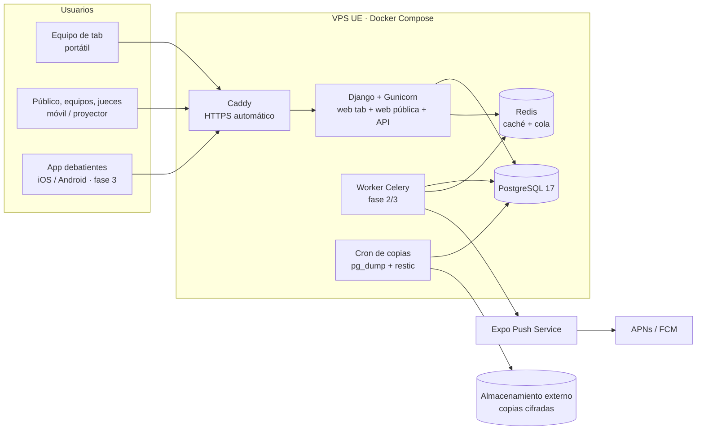

# Arquitectura

## 1. Visión general



Un único proyecto Django sirve tres superficies: la **herramienta de tab** (autenticada), la **web pública** (sin login, cacheada) y, en fase 3, la **API REST** para la app móvil, que vive en un repositorio aparte (`tabes-app`).

**Marca blanca**: la organización se identifica por el dominio de la petición (p. ej. `tab.<dominio-de-ada>` → ADA). Con ella se cargan nombre, logo, colores (como variables CSS), favicon y textos legales en todas las páginas y correos. Si no hay dominio propio, se usa una ruta con el slug de la organización. Una sola instalación puede servir a varias asociaciones; o, si una lo prefiere, se le despliega una instalación propia con la misma imagen Docker.

## 2. Stack

| Capa | Elección | Motivo |
|---|---|---|
| Lenguaje | Python 3.13 | Ecosistema científico para los algoritmos (`networkx`, `scipy`). |
| Framework | Django 5.2 LTS (migrar a 6.2 LTS en 2027) | Admin, auth, migraciones, formularios e i18n incluidos: reduce mucho el coste del CRUD. |
| Base de datos | PostgreSQL 17 | Restricciones parciales, `JSONB`, `citext`, transacciones robustas. |
| Interfaz | Plantillas Django + HTMX 2 + Alpine.js 3 + SortableJS | Interactividad (arrastrar y soltar, recargas parciales) sin mantener una SPA. |
| Estilos | Tailwind CSS 4 (CLI standalone, sin Node en producción) | Rápido de maquetar, responsive. |
| Excel/CSV | `openpyxl` + `csv` estándar | Importación (fase 1) y exportación (fase 2). |
| PDF | WeasyPrint | Exportación (fase 2). |
| Algoritmos | `networkx` (emparejamiento de coste mínimo), `scipy.optimize.linear_sum_assignment` (asignación húngara) | Algoritmos probados en vez de heurísticas caseras. |
| Caché y cola | Redis 7 + Celery (cola desde fase 2/3) | Caché compartida de páginas públicas; envíos push asíncronos. |
| API | Django REST Framework + drf-spectacular (OpenAPI) | Contrato tipado para la app; cliente TS generado. |
| Dependencias | uv | Rápido y reproducible (`uv.lock`). |
| Calidad | ruff (lint + formato), mypy + django-stubs, pytest, pytest-django, factory_boy, Hypothesis, Playwright | |
| Tareas | poethepoet (`uv run poe <tarea>`) | Funciona igual en Windows, macOS y Linux. |
| Servidor | Caddy 2 + Gunicorn | HTTPS automático con Let's Encrypt. |
| Observabilidad | Sentry (plan gratuito), UptimeRobot (gratuito), logs JSON | |
| CI/CD | GitHub Actions | Lint + tests → imagen Docker → despliegue por SSH. |
| App móvil (fase 3) | React Native + Expo (TypeScript), Expo Router, TanStack Query, expo-notifications, EAS Build/Submit/Update | Un código para iOS y Android; push gratuito vía Expo. |

## 3. Estructura del código (prevista)

```
ada-tabulacion/
├── config/                 # settings/{base,dev,prod}.py, urls.py, wsgi.py, celery.py
├── apps/
│   ├── core/               # Organization, Person, User, AuditLog, utilidades comunes
│   ├── tournaments/        # Tournament, FormatTemplate, TournamentRules, Round, Motion
│   ├── participants/       # Institution, Team, Speaker, Adjudicator, Venue, categorías, importación
│   ├── conflicts/          # Conflictos
│   ├── draw/               # Debate, DebateTeam · engine/ (emparejamientos puros)
│   ├── allocation/         # DebateAdjudicator · engine/ (asignación de jueces y salas)
│   ├── results/            # Ballot, hojas, agregados, validación
│   ├── standings/          # Métricas, desempates, break
│   ├── public/             # Vistas públicas cacheadas, modo proyector
│   ├── api/                # Fase 3: API REST para la app
│   └── notifications/      # Fase 3: dispositivos, avisos, push
├── templates/  static/
├── tests/                  # e2e/ (Playwright), load/ (Locust), fixtures/ compartidas
├── deploy/                 # docker-compose.prod.yml, Caddyfile, backup.sh, restore.md
├── docs/  specs/
└── pyproject.toml · uv.lock · Dockerfile · docker-compose.yml
```

Dentro de cada app: `models.py`, `services/` (casos de uso con transacciones y auditoría), `engine/` cuando hay algoritmos (código **puro**: recibe dataclasses, no toca el ORM), `forms.py`, `views.py`, `urls.py`, `templates/<app>/`, `tests/`.

## 4. Patrones

- **Capas**: vista → servicio → (motor puro) → modelos. Las vistas no contienen reglas de negocio; los modelos solo campos, restricciones y propiedades triviales.
- **Motores puros**: `draw.engine` y `allocation.engine` reciben estructuras inmutables (equipos, historial, conflictos, configuración, semilla) y devuelven una propuesta. Se testean sin base de datos y con Hypothesis.
- **Transacciones**: generar draw, guardar asignaciones y confirmar boletas ocurren en `transaction.atomic` con `select_for_update` o bloqueo optimista (`version`).
- **HTMX**: formularios y tablas se actualizan por fragmentos; el tablero de jueces usa SortableJS y envía cada movimiento al servidor (autoguardado); si el `version` no coincide, se avisa y se recarga.
- **Publicación**: las vistas públicas se cachean en Redis por torneo y ronda; publicar o despublicar invalida la caché. Las páginas incluyen sondeo ligero (HTMX cada 30 s) para mostrar "hay una versión nueva".
- **Configuración**: listas de reglas en `JSONB` validadas con esquemas (pydantic) al guardar.

## 5. Algoritmos (enfoque)

Detalle y criterios en las specs 003 y 004; aquí solo la estrategia.

- **Emparejamiento 2 equipos (Académico)**: brackets por puntos; pull-ups según regla configurada; emparejamiento de coste mínimo sobre todo el campo (`networkx.min_weight_matching`) donde el coste penaliza diferencia de bracket, revanchas (muy alto), misma institución y desequilibrio de posiciones. Asignación de lado por historial de posiciones.
- **Emparejamiento BP**: brackets por puntos en grupos de 4 con pull-ups; asignación simultánea de equipos a salas y posiciones con el método húngaro minimizando el coste de desequilibrio de posiciones (`squared` o `entropy`).
- **Asignación de jueces**: ordenar debates por importancia; asignación húngara de presidentes (mejores notas a debates más importantes) con coste infinito para conflictos duros y penalización por "ya vio a este equipo"; después vocales y jueces en prácticas.
- **Salas**: asignación por prioridad de sala frente a importancia del debate, respetando accesibilidad.

## 6. Despliegue e infraestructura

- **Entornos**: `dev` (local con Docker Compose), `staging` (mismo servidor, otro proyecto Compose y subdominio) y `prod`.
- **Contenedores**: `caddy`, `web` (Gunicorn, 3–5 workers), `db` (PostgreSQL), `redis`, `worker` (fase 2/3), `backup` (cron).
- **Dominio**: subdominio del dominio de ADA (p. ej. `tab.<dominio-ada>`), sin coste adicional.
- **Perfil de carga**: un Nacional al año (2–3 días con 100–250 personas a la vez) y uso residual el resto del año. Por eso: **servidor pequeño todo el año y refuerzo puntual para el Nacional**, en vez de pagar todo el año por el pico.
- **Proveedor**: cualquier VPS de la UE. Base: 2 vCPU / 4 GB RAM / 40 GB SSD. Opciones a nov. 2026: OVHcloud VPS-1 (desde 3,81 €/mes), Hetzner CX23 (5,99 €/mes, disponibilidad intermitente). Todo está dockerizado, así que cambiar de proveedor cuesta horas, no semanas.
- **Refuerzo para el Nacional** (solo si la prueba de carga lo pide): ampliar el VPS a 4 vCPU / 8 GB la semana del torneo, facturado por horas (en Hetzner, sin ampliar el disco para poder volver al plan pequeño), o poner Cloudflare (plan gratuito) delante de las páginas públicas, purgando su caché al publicar. Procedimiento en `deploy/nacional.md`.
- **CI/CD**: en cada PR, lint + tipos + tests. En `main`, construcción de imagen y despliegue a staging; producción con etiqueta de versión.

## 7. Dimensionado (objetivo: 250 usuarios simultáneos, diseño para 500)

- **Pico real**: cuando se publica el draw, todo el torneo recarga a la vez. 250 personas × 2–3 peticiones en ~10 s ≈ 50–75 peticiones/s durante unos segundos.
- **Capacidad**: una página pública servida desde caché Redis cuesta pocos milisegundos; 4 workers Gunicorn en 2 vCPU atienden con holgura varios cientos de peticiones/s cacheadas. La herramienta de tab la usan 2–6 personas: carga despreciable.
- **Memoria (4 GB)**: PostgreSQL ~1 GB, 4 workers × ~150 MB, Redis < 100 MB, Caddy y sistema ~500 MB. Margen amplio.
- **Datos**: un torneo de 20 equipos y 6 rondas genera unos pocos miles de filas. Decenas de torneos al año caben en menos de 1 GB.
- **Push (fase 3)**: 250 dispositivos = 3 peticiones de lote a Expo (100 mensajes por petición). Trivial.
- **Resto del año**: carga prácticamente nula; el servidor base va sobrado.
- **Verificación**: prueba de carga con Locust de 500 usuarios virtuales unas 3 semanas antes del Nacional, en el servidor real; criterio p95 < 500 ms en páginas públicas. Si no se cumple, se aplica el refuerzo de §6.

## 8. Copias de seguridad y recuperación

| Qué | Frecuencia | Retención | Dónde |
|---|---|---|---|
| `pg_dump` cifrado (restic) | diario; **cada hora en días de torneo** | 7 diarias, 4 semanales, 12 mensuales | almacenamiento de objetos externo en su plan gratuito (Backblaze B2 o Cloudflare R2, 10 GB; la BD ocupa pocos MB) |
| Snapshot del servidor | semanal | 4 | proveedor del VPS |
| Exportación JSON del torneo | botón manual, antes de cada ronda | — | descarga del tab |

Objetivos: **RPO ≤ 1 h** en días de torneo, **RTO ≤ 1 h**. Simulacro de restauración documentado en `deploy/restore.md` y ensayado cada trimestre y antes de cada torneo importante.

Plan B en directo: draw imprimible desde el navegador (CSS de impresión) y exportación del torneo, para seguir con papel si cayera el servidor.

## 9. Seguridad

- HTTPS obligatorio (HSTS), cookies `Secure`/`HttpOnly`/`SameSite`, CSRF de Django, cabeceras de seguridad (CSP).
- Contraseñas con el hasher por defecto de Django; restablecimiento por email; 2FA para administradores en fase 2.
- Enlaces privados (boletas electrónicas, feedback) con tokens ≥ 128 bits, revocables, con limitación de peticiones.
- Secretos solo en variables de entorno; nunca en el repositorio.
- Actualizaciones de seguridad del sistema y dependencias mensuales (Dependabot).

## 10. Privacidad (RGPD / LOPDGDD)

- ADA es **responsable del tratamiento**; el desarrollador que aloja y mantiene es **encargado** → contrato de encargo del tratamiento (art. 28 RGPD).
- Datos mínimos: nombre, email, institución. Sin fecha de nacimiento ni DNI.
- Menores: en España, el consentimiento propio es válido desde los 14 años (art. 7 LOPDGDD); por debajo, consentimiento de padres o tutores (relevante sobre todo para las cuentas de la app).
- Web pública: opción de mostrar solo iniciales y de no indexar en buscadores.
- Servidores y copias en la UE.
- Derecho de supresión: borrado o anonimización de `Person` conservando la integridad de resultados históricos.

## 11. Decisiones de arquitectura (ADR)

| ADR | Decisión | Alternativas descartadas |
|---|---|---|
| 001 | Monolito Django | FastAPI (habría que construir admin, auth y migraciones a mano); NestJS (sin ventaja para este dominio). |
| 002 | Plantillas + HTMX en vez de SPA React/Vue | SPA: dobla el trabajo (API + frontend) en la fase 1, donde la API solo hace falta para la app (fase 3). |
| 003 | PostgreSQL con integridad en BD | Validación solo en aplicación. |
| 004 | Identidad global `Person` | Personas por torneo (modelo de Tabbycat): impide histórico y cuentas de la app. |
| 005 | `Organization` desde el inicio | Añadirla después exige migrar todos los datos. |
| 006 | VPS pequeño + Docker Compose todo el año, con refuerzo puntual para el Nacional | VPS grande todo el año (se paga el pico 362 días sin uso); PaaS (Render, Railway): más caro a igualdad de recursos y con dependencia del proveedor. |
| 007 | Expo / React Native para la app | Flutter (otro lenguaje); nativo doble (coste ×2); PWA (más barata, pero no está en las tiendas y las notificaciones en iOS exigen instalarla en la pantalla de inicio). |
| 008 | Diseño propio, sin partir de un fork de Tabbycat | Hacer fork de Tabbycat: su modelo es por torneo (sin identidad global ni marca blanca). Como TabES también es AGPL, se puede reutilizar código puntual de Tabbycat con atribución. |
| 010 | Código abierto: AGPL-3.0-or-later en la web, MIT en la app | Privativo (no serviría de portfolio público y complica la continuidad para ADA); MIT en todo (permitiría a terceros cerrarlo y ofrecerlo como servicio); GPL en la app (problemas con los términos de App Store). |
| 009 | Marca blanca por organización, resuelta por dominio, con tema en variables CSS | Una instalación o un fork por cliente (multiplica el mantenimiento); marca fija de ADA (impediría ofrecer TabES a otras asociaciones). |
