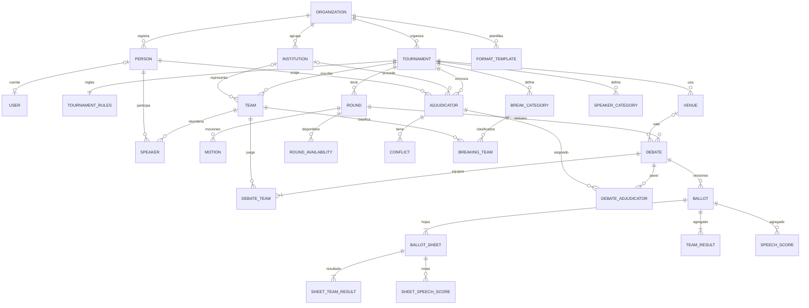

# Modelo de datos

> Documento vivo y **fuente de verdad** del esquema. Todo cambio de modelo se propone aquí (en el `plan.md` de la spec que lo necesite) antes de escribir la migración.
> Base de datos: PostgreSQL 17. Nombres de tablas y campos en inglés; descripciones en español.

## 1. Decisiones de modelado

| # | Decisión | Por qué |
|---|---|---|
| M1 | **Identidad global `Person`** separada de su participación por torneo (`Speaker`, `Adjudicator`). | Permite histórico entre torneos, estadísticas personales y cuentas de la app móvil (fase 3) sin duplicar personas. |
| M2 | **`Organization`** desde el día 1, con su identidad visual (marca blanca). En el MVP solo existe ADA. | TabES se ofrecerá a otras asociaciones; cada una ve su marca. Añadirlo después exigiría migrar todos los datos. |
| M3 | **Reglas copiadas al torneo** (`TournamentRules`), a partir de plantillas (`FormatTemplate`). | Cambiar una plantilla nunca altera torneos pasados. |
| M4 | **Posición como índice** (`side` 0..N-1) con etiquetas en las reglas. | Un único modelo para Académico (2 equipos) y BP (4 equipos). |
| M5 | **`round_id` desnormalizado** en `DebateTeam` y `DebateAdjudicator`. | Permite que PostgreSQL garantice "un equipo/juez como máximo una vez por ronda" con un `UNIQUE`. |
| M6 | **Boletas versionadas e inmutables una vez confirmadas.** Corregir = nueva versión. | Trazabilidad ante reclamaciones; nunca se pierde un resultado. |
| M7 | **Hojas de boleta** (`BallotSheet`): una por juez (voto individual) o una única (consenso). Resultados agregados en `TeamResult`/`SpeechScore` al confirmar. | Soporta ambos modos de panel sin ramas en las consultas de clasificación. |
| M8 | **Clasificaciones calculadas**, no almacenadas (solo boletas confirmadas). | Siempre coherentes; con 250 personas el cálculo es instantáneo. Se cachean en Redis. |
| M9 | **Configuración tipada** en columnas; listas (turnos, desempates, rúbrica) en `JSONB` validado por esquema. | Validación fuerte sin multiplicar tablas de configuración. |
| M10 | **Integridad en la base de datos**: `UNIQUE`, `CHECK` y `UNIQUE` parciales, no solo validación en Python. | El tab no puede quedar en estado imposible aunque haya un bug o dos personas editando a la vez. |
| M11 | Claves `bigint` internas; **slugs** para URLs públicas; **tokens aleatorios** (≥128 bits) para enlaces privados. | Sin IDs secuenciales enumerables en lo público. |
| M12 | **Bajas lógicas** (`status`) para equipos, jueces y salas con histórico. | Un equipo retirado conserva sus resultados. |
| M13 | **Bloqueo optimista** (`version`) en `Round` y `Debate`. | Dos miembros del tab editando el mismo draw/panel reciben aviso en vez de pisarse. |

Todas las tablas llevan `created_at` y `updated_at`.

## 2. Diagrama (MVP)

`CONFLICT` y `ROUND_AVAILABILITY` agrupan varias tablas (ver §3.5 y §3.6).

## 3. Entidades del MVP (fase 1)

### 3.1 Núcleo

**`Organization`** — asociación cliente y su identidad visual.
| Campo | Tipo | Notas |
|---|---|---|
| name | varchar(150) | nombre legal |
| display_name | varchar(80) | nombre visible en la web, p. ej. "Debate Alicante" |
| slug | slug | único; ruta de respaldo `/o/<slug>/` |
| domain | varchar null | dominio propio, único (p. ej. `tab.<dominio-de-ada>`) |
| logo, logo_dark, favicon | imagen | logo para tema claro y oscuro |
| primary_color, accent_color | char(7) | hexadecimal; se validan contraste AA contra blanco/negro |
| contact_email | email | remitente y respuesta de los correos |
| privacy_policy_url, legal_notice_url | url null | textos legales de la asociación |
| default_locale | varchar | `es` por defecto |

**`User`** (auth de Django, login por email) — `email` (único), `password`, `is_active`, `is_staff`. En fase 1 solo lo usan administradores y equipo de tab.

**`Person`** — identidad global.
| Campo | Tipo | Notas |
|---|---|---|
| organization | FK | |
| full_name | varchar(150) | |
| display_name | varchar(80) | nombre corto opcional |
| email | citext null | `UNIQUE(organization, email)` cuando no es null |
| pronouns | varchar(30) null | opcional |
| user | O2O → User null | se vincula cuando la persona crea cuenta (fase 3) |

Datos mínimos a propósito (RGPD): nada de fecha de nacimiento, DNI ni teléfono en el MVP.

**`AuditLog`** (solo inserción) — `organization`, `tournament` null, `user` null, `action` (código, p. ej. `draw.generate`, `ballot.confirm`), `object_type`, `object_id`, `summary`, `data` JSONB (antes/después), `ip`, `created_at`. Índice por `(tournament, created_at)`.

### 3.2 Torneo y reglas

**`Tournament`**
| Campo | Tipo | Notas |
|---|---|---|
| organization | FK | |
| name, short_name | varchar | |
| slug | slug | `UNIQUE(organization, slug)`; se usa en URLs públicas |
| status | enum | `draft`, `active`, `finished`, `archived` (archivado = solo lectura) |
| start_date, end_date | date | `CHECK end_date >= start_date` |
| location | varchar null | |
| timezone | varchar | por defecto `Europe/Madrid` |
| is_public | bool | si la web pública existe |
| public_name_display | enum | `full`, `initials`, `hidden` (privacidad, menores) |
| public_speaker_scores | enum | `never`, `after_tournament`, `live` |

**`FormatTemplate`** (por organización) y **`TournamentRules`** (1:1 con `Tournament`) comparten estos campos (modelo abstracto común):

| Campo | Tipo | Ejemplo Académico | Ejemplo BP |
|---|---|---|---|
| teams_per_debate | smallint `CHECK IN (2,4)` | 2 | 4 |
| side_labels | JSONB list[str] | `["A favor","En contra"]` | `["Cámara Alta a favor", …]` |
| speech_slots | JSONB list[slot] | 12 turnos (ver glosario) | 8 turnos |
| speakers_per_team_min / max | smallint | ⚠ / 5 | 2 / 2 |
| score_min / score_max / score_step | decimal(5,2) | ⚠ | ⚠ (50 / 100 / 1) |
| points_by_rank | JSONB list[int] | `[1,0]` | `[3,2,1,0]` |
| draws_allowed / points_for_draw | bool / smallint | ⚠ | false |
| winner_rule | enum | `by_totals` o `declared` | `by_totals` |
| allow_low_point_win | bool | ⚠ | false |
| ballot_mode | enum | `consensus` o `individual` ⚠ | `consensus` |
| individual_score_aggregation | enum | `mean_all`, `mean_majority` | — |
| iron_man_allowed | bool | | |
| rubric | JSONB list[criterion] null | ⚠ si ADA puntúa por criterios | null |
| default_panel_size / trainees_allowed | smallint / bool | | |
| pairing_method | enum | `slide`, `fold`, `random` | — |
| pullup_rule | enum | `top`, `bottom`, `random`, `fewest_pullups` | idem |
| avoid_same_institution | bool | | |
| odd_team_policy | enum | `swing`, `bye` | `swing` |
| bp_position_cost | enum | — | `squared`, `entropy` |
| team_tiebreaks | JSONB list[str] | `["points","speaker_total","draw_strength"]` | `["points","speaker_total","firsts","seconds"]` |
| speaker_tiebreaks | JSONB list[str] | `["total","average"]` | |
| speaker_min_rounds | smallint | | |
| own_institution_conflict | bool | genera conflicto juez–su institución | |
| prep_time_s, deliberation_s, feedback_s | int | 600 / 900 (cronómetro) | |
| elim_side_rule | enum | `higher_seed_chooses`, `random`, `balanced` | idem |
| elim_speaker_scores | bool | ⚠ | ⚠ |
| elim_panel_size | smallint | 3 | 3 |

Esquema de `speech_slots`: `{order, side, label, duration_s, scored: bool, kind: "speech"|"questions"|"reply"}`.
Esquema de `rubric`: `{key, label, min, max, weight}`.
Las claves de desempate se validan contra el registro de métricas (spec 006).

**`Round`**
| Campo | Tipo | Notas |
|---|---|---|
| tournament | FK | |
| seq | smallint | `UNIQUE(tournament, seq)` |
| name, abbreviation | varchar | "Ronda 1", "R1" |
| stage | enum | `prelim`, `elim` (spec 008) |
| draw_type | enum | `random`, `power_paired`, `manual`, `elimination` |
| status | enum | `setup` → `draw_draft` → `draw_confirmed` → `in_progress` → `completed` |
| starts_at | timestamptz null | |
| is_silent | bool | |
| break_category | FK null | solo eliminatorias |
| draw_seed | bigint null | semilla del último draw generado (reproducible) |
| draw_released_at, motions_released_at, results_released_at | timestamptz null | publicación explícita |
| version | int | bloqueo optimista |

**`Motion`** — `round`, `seq`, `text`, `infoslide` null, `short_name` null. `UNIQUE(round, seq)`. Visible en público solo si `round.motions_released_at` no es null.

### 3.3 Participantes

**`Institution`** — `organization`, `name`, `code` (abreviatura). `UNIQUE(organization, code)`. Global: se reutiliza entre torneos.

**`Team`**
| Campo | Tipo | Notas |
|---|---|---|
| tournament | FK | |
| institution | FK null | null = equipo mixto/sin institución |
| name, short_name | varchar | `UNIQUE(tournament, name)` |
| code_name | varchar null | nombre en clave opcional |
| is_swing | bool | no clasifica |
| status | enum | `active`, `withdrawn` |
| seed | smallint null | sembrado opcional para ronda 1 |
| needs_accessible_venue | bool | |

**`Speaker`** — `tournament` (desnormalizado), `team`, `person`. `UNIQUE(tournament, person)` (una persona, un equipo por torneo). M2M `categories` → `SpeakerCategory`.

**`SpeakerCategory`** — `tournament`, `name`, `slug`, `is_public`, `min_rounds` null. Ej.: "Noveles".

**`Adjudicator`**
| Campo | Tipo | Notas |
|---|---|---|
| tournament | FK | |
| person | FK | `UNIQUE(tournament, person)` |
| institution | FK null | null = independiente |
| base_score | decimal(4,2) | nota/nivel; `CHECK` dentro del rango configurado por la organización (p. ej. 1–5) |
| is_trainee | bool | solo puede ir como juez en prácticas |
| needs_accessible_venue | bool | |
| status | enum | `active`, `withdrawn` |

**`Venue`** — `tournament`, `name`, `building` null, `priority` (mayor = mejor sala), `capacity` null, `is_accessible`, `status`. `UNIQUE(tournament, name)`.

### 3.4 Disponibilidad por ronda

`RoundTeamAvailability(round, team)`, `RoundAdjudicatorAvailability(round, adjudicator)`, `RoundVenueAvailability(round, venue)`, cada una con `UNIQUE` del par. Al crear una ronda se copian de la anterior (o se marcan todos los activos en la primera).

### 3.5 Conflictos

| Tabla | Campos | Restricciones |
|---|---|---|
| `AdjudicatorTeamConflict` | adjudicator, team, source (`manual`/`import`), note | `UNIQUE(adjudicator, team)` |
| `AdjudicatorInstitutionConflict` | adjudicator, institution, source (`auto`/`manual`/`import`), note | `UNIQUE(adjudicator, institution)` |
| `AdjudicatorAdjudicatorConflict` | adjudicator_a, adjudicator_b, note | `CHECK adjudicator_a_id < adjudicator_b_id`, `UNIQUE(a, b)` |
| `TeamInstitutionConflict` | team, institution, note | `UNIQUE(team, institution)` |

Un conflicto juez–institución equivale a conflicto con todos los equipos de esa institución. `source=auto` se genera desde `Adjudicator.institution` si `own_institution_conflict` está activo.

### 3.6 Draw

**`Debate`**
| Campo | Tipo | Notas |
|---|---|---|
| round | FK | |
| venue | FK null | `UNIQUE(round, venue) WHERE venue IS NOT NULL` |
| bracket | decimal(5,2) | puntos del bracket |
| room_rank | smallint | orden dentro de la ronda |
| importance | smallint | `CHECK BETWEEN -2 AND 2` |
| warnings | JSONB | avisos calculados (revancha, misma institución, desequilibrio de posición) |
| bracket_slot | smallint null | posición en el cuadro de eliminatorias (define quién se cruza después); `UNIQUE(round, bracket_slot)` |
| result_status | enum | `none`, `draft`, `confirmed` (desnormalizado para listados) |
| version | int | bloqueo optimista |

**`DebateTeam`** — `debate`, `round` (desnorm.), `team`, `side` (smallint), `flags` JSONB (`pullup`, …).
Restricciones: `UNIQUE(debate, side)`, `UNIQUE(round, team)`, `CHECK side BETWEEN 0 AND 3`.

**`DebateAdjudicator`** — `debate`, `round` (desnorm.), `adjudicator`, `role` (`chair`, `panellist`, `trainee`).
Restricciones: `UNIQUE(round, adjudicator)`, `UNIQUE(debate) WHERE role = 'chair'`.

### 3.7 Resultados

**`Ballot`**
| Campo | Tipo | Notas |
|---|---|---|
| debate | FK | |
| version | smallint | `UNIQUE(debate, version)` |
| status | enum | `draft`, `submitted`, `confirmed`, `discarded`; `UNIQUE(debate) WHERE status = 'confirmed'` |
| source | enum | `tab`, `eballot` (fase 2) |
| motion | FK null | moción debatida si hay varias |
| forfeit_side | smallint null | incomparecencia |
| entered_by | FK User null | |
| entered_by_adjudicator | FK null | boleta electrónica (fase 2) |
| confirmed_by, confirmed_at | FK User null, timestamptz null | |
| discard_reason | text null | obligatorio al descartar una confirmada |

**`BallotSheet`** — `ballot`, `adjudicator` null (null = consenso). `UNIQUE(ballot, adjudicator)`.
**`SheetTeamResult`** — `sheet`, `debate_team`, `rank` (1 = mejor), `speaker_total`. `UNIQUE(sheet, debate_team)`, `UNIQUE(sheet, rank)` salvo empate permitido.
**`SheetSpeechScore`** — `sheet`, `debate_team`, `slot_order`, `speaker`, `score` decimal(5,2), `criteria` JSONB null (rúbrica). `UNIQUE(sheet, debate_team, slot_order)`.

Agregados (se escriben al confirmar, en la misma transacción):
**`TeamResult`** — `ballot`, `debate_team`, `rank`, `points`, `is_win`, `speaker_total`, `margin`, `votes_won`. `UNIQUE(ballot, debate_team)`.
**`SpeechScore`** — `ballot`, `debate_team`, `slot_order`, `speaker`, `score`, `is_iron`. `UNIQUE(ballot, debate_team, slot_order)`.

Las clasificaciones solo leen `TeamResult`/`SpeechScore` de boletas `confirmed`.

### 3.8 Break

**`BreakCategory`** — `tournament`, `name`, `slug`, `size`, `priority`, `is_general`, `institution_cap` null, `released_at` null. `UNIQUE(tournament, slug)`.
**`TeamBreakEligibility`** — M2M `(category, team)`.
**`BreakingTeam`** — `category`, `team`, `standing_rank`, `break_rank` null, `remark` enum null (`capped`, `ineligible`, `different_break`, `disqualified`, `withdrawn`, `manual`), `note`. `UNIQUE(category, team)`.

## 4. Fase 2 (tabulación ampliada)

| Entidad | Campos clave | Para |
|---|---|---|
| `TournamentMembership` | user, tournament, role (`admin`, `tab`, `ca`, `adjudicator`) — `UNIQUE(user, tournament, role)` | Roles y permisos |
| `Adjudicator.private_url_key`, `Team.private_url_key` | token único, revocable | Boletas electrónicas y feedback sin cuenta |
| `FeedbackQuestion` | tournament, seq, text, type (`score`,`text`,`bool`,`choice`), required, from_teams, from_adjudicators, choices | Feedback |
| `FeedbackSubmission` | debate, source_team null / source_adjudicator null, target_adjudicator, score, version, status | Feedback |
| `FeedbackAnswer` | submission, question, value JSONB | Feedback |
| `Tournament.feedback_weight` | peso del feedback en la nota del juez | Asignación |

Las eliminatorias (`Round(stage=elim)` + `break_category` + `Debate.bracket_slot`) se adelantaron a la fase 1 (spec 008) porque el Nacional las necesita.

## 5. Fase 3 (app de debatientes)

| Entidad | Campos clave | Para |
|---|---|---|
| `Invitation` | person, email, token_hash, expires_at, accepted_at | Alta de cuentas vinculadas a `Person` |
| `Consent` | user, kind (`terms`, `privacy`, `parental`), version, granted_at, parent_email null | RGPD y menores |
| `Device` | user, push_token (único), platform, app_version, locale, last_seen_at, is_active | Push |
| `NotificationPreference` | user, category, enabled — `UNIQUE(user, category)` | Preferencias |
| `ScheduleItem` | tournament, round null, title, starts_at, ends_at, location, notify_on_change | Horario en vivo |
| `Notification` | organization, tournament null, category, title, body, data JSONB (enlace profundo), audience (`tournament`, `team`, `person`, `adjudicators`), audience_ref, created_by, scheduled_for, status, sent_at | Avisos |
| `NotificationDelivery` | notification, device, user, ticket_id, status, error_code, receipt_checked_at | Entrega y limpieza de tokens |
| `UserNotification` | user, notification, read_at | Bandeja de avisos en la app |

## 6. Invariantes que la BD debe garantizar (resumen para tests)

1. Un equipo juega como máximo un debate por ronda. (`UNIQUE(round, team)`)
2. Un juez está como máximo en un debate por ronda. (`UNIQUE(round, adjudicator)`)
3. Una posición por equipo y debate. (`UNIQUE(debate, side)`)
4. Un único presidente por debate. (`UNIQUE(debate) WHERE role='chair'`)
5. Una única boleta confirmada por debate. (`UNIQUE(debate) WHERE status='confirmed'`)
6. Una sala como máximo en un debate por ronda. (`UNIQUE(round, venue)`)
7. Una persona en un único equipo por torneo. (`UNIQUE(tournament, person)` en `Speaker`)

Invariantes que garantiza el código (y se prueban): número de equipos por debate = `teams_per_debate`; puntuaciones dentro de rango y paso; coherencia ganador/totales según `winner_rule`; nada público sin `*_released_at`.
